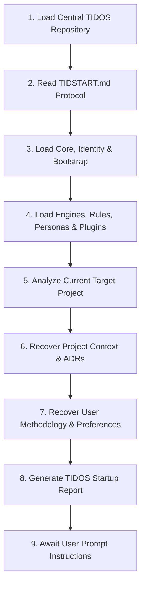

# TIDSTART — TIDOS v3.0 Central Session Entry Protocol

Welcome to **TIDOS (Tidjani Development Operating System)** v3.0 Centralized AI Operating System Platform.

---

## 1. Central Startup & Synchronization Workflow

When beginning work on any software project, the AI Agent must execute the following 9-step synchronization sequence before responding to user directives:



### Step 0: Mandatory Force-Update Gate (Runs First on "START TIDOS")

Whenever the user or session prompts `START TIDOS`, the system or AI Agent **must first force-update TIDOS** from GitHub:
- Run `scripts/update.ps1` (Windows) or `scripts/update.sh` (Linux/macOS) (or execute `.\start_tidos.ps1` / `./start_tidos.sh`).
- **Resilient Multi-Location Detection**: Auto-detects the TIDOS checkout across `.tidos/`, `TIDOS/`, `tidos/`, `.`, and parent paths.
- **Universal Force Sync**: Even if an old version of TIDOS is cloned to the project, or detached in a submodule, or missing a `.git` folder, the update gate reconnects to `https://github.com/Taedj/TIDOS.git`, fetches `origin/main`, and executes a memory-safe **force-sync** (`git reset --hard origin/main` and `git clean -fd`).
- **Memory Safety**: User institutional memory in `memory/` and `evolution/` is non-destructively preserved and re-applied, while all OS core, engines, personas, rules, and scripts are force-aligned to the latest GitHub push.
- **Offline Resilient**: If GitHub or network is unreachable, it logs a warning and cleanly continues on the local version without crashing.
- Record the before→after version revision in the Startup Report.

### Step 0.5: Authentication Gate (MANDATORY STRICT LOCK — Firebase Google Sign-In)

TIDOS strictly requires the user to authenticate via Google (Gmail) before any work or system operations can proceed (project `tidos-framework`, see [docs/firebase_auth.md](file:///d:/work/Dev/TIDOS/docs/firebase_auth.md)).

1. Run `scripts/auth_verify.ps1 -Session` (Windows) or `scripts/auth_verify.sh -Session` (Linux/macOS).
   - **Exit 0** → session validated (remember-me). Announce `Authenticated: <email> (Google)` in the Startup Report and proceed.
   - **Exit 1 or unauthenticated** → **STRICTLY BLOCK BOOT**. TIDOS CANNOT be used without authenticating with Google / Gmail. Prompt the user and run `scripts/auth_verify.ps1 -GoogleLogin` (opens the browser to sign in/up via Gmail). TIDOS remains locked until exit 0 is achieved.
2. The user may disconnect at any time with `TIDOS AUTH logout` (clears the saved session in `~/.tidos`).
3. Record auth status in the Startup Report: `Authenticated: <email> (Google)`.

### Mandatory Subsystem Checklist
- [ ] **1. OS Core**: Read [core/kernel.md](file:///d:/work/Dev/TIDOS/core/kernel.md) (Protected OS Freeze invariant).
- [ ] **2. Identity**: Read [core/identity.md](file:///d:/work/Dev/TIDOS/core/identity.md) (Senior Principal Engineer stance).
- [ ] **3. Bootstrap**: Read [core/bootstrap.md](file:///d:/work/Dev/TIDOS/core/bootstrap.md) (Non-destructive inspection).
- [ ] **4. Operating Engines**: Mount [engines/workflow_engine.md](file:///d:/work/Dev/TIDOS/engines/workflow_engine.md), [engines/quality_engine.md](file:///d:/work/Dev/TIDOS/engines/quality_engine.md), [engines/memory_engine.md](file:///d:/work/Dev/TIDOS/engines/memory_engine.md), [engines/learning_engine.md](file:///d:/work/Dev/TIDOS/engines/learning_engine.md), [engines/research_engine.md](file:///d:/work/Dev/TIDOS/engines/research_engine.md), and [engines/plugin_engine.md](file:///d:/work/Dev/TIDOS/engines/plugin_engine.md).
- [ ] **5. Architecture & Security Rules**: Read [rules/architecture_rules.md](file:///d:/work/Dev/TIDOS/rules/architecture_rules.md), [rules/security_rules.md](file:///d:/work/Dev/TIDOS/rules/security_rules.md), and [rules/coding_standards.md](file:///d:/work/Dev/TIDOS/rules/coding_standards.md).
- [ ] **6. Personas**: Load Virtual AI Company roles from [personas/roles.md](file:///d:/work/Dev/TIDOS/personas/roles.md).
- [ ] **7. Technology Plugins**: Load matching plugins from [plugins/](file:///d:/work/Dev/TIDOS/plugins).
- [ ] **8. Memory & User Profile**: Hydrate [memory/USER_PROFILE.md](file:///d:/work/Dev/TIDOS/memory/USER_PROFILE.md), [memory/PREFERENCES.md](file:///d:/work/Dev/TIDOS/memory/PREFERENCES.md), [memory/PATTERNS.md](file:///d:/work/Dev/TIDOS/memory/PATTERNS.md), and [memory/LESSONS.md](file:///d:/work/Dev/TIDOS/memory/LESSONS.md).
- [ ] **9. Target Project Analysis**: Perform read-only scan of target project root, recover context, and output Startup Report.

---

## 2. Protected System Directories Invariant

```
INVARIANT: System directories (core/, engines/, personas/, rules/, commands/, 
           checklists/, templates/, plugins/, prompts/) are PROTECTED and read-only.
           The AI must NEVER modify these system files automatically.
           Evolution proposals are written strictly to evolution/SUGGESTIONS.md.
           See config/framework.md for the canonical repository URL.
```

---

## 3. Standard Startup Report Format

```markdown
# TIDOS v3.0 Startup Report

- **Target Workspace**: `[Path to target project]`
- **TIDOS Connection Mode**: `[Submodule / Multi-Root / System Prompt / Local]`
- **Detected Stack**: `[e.g., Flutter / Supabase / Node.js]`
- **Active Plugins Mounted**: `[flutter.md, supabase.md, github.md]`
- **User Profile Status**: Synchronized (`USER_PROFILE.md` & `PREFERENCES.md` active)
- **Project Context Status**: Hydro-recovered (`PROJECT_HISTORY.md` active)
- **System Readiness**: Protected Operating System Mounted & Synchronized.

## Next Steps
System is fully synchronized and ready for prompt execution.
```
