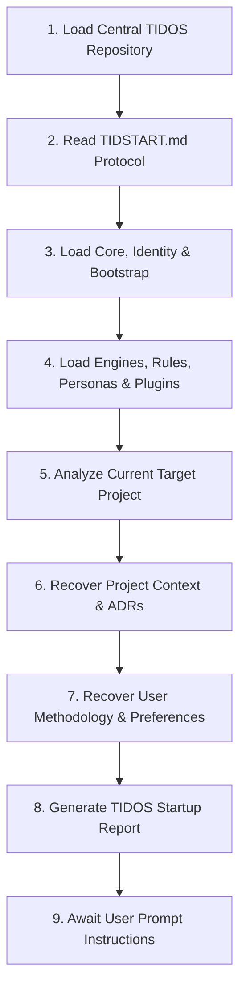

# TIDSTART — TIDOS Central Session Entry Protocol

Welcome to **TIDOS (Tidjani Development Operating System)**. The version is in `VERSION.md`.

---

## 1. Central Startup & Synchronization Workflow

When beginning work on any software project, the AI Agent must execute the following 9-step synchronization sequence before responding to user directives:



### Step 0: Update Gate (reports first, installs only when approved)

`START TIDOS` checks GitHub for a newer TIDOS (`scripts/update.ps1` / `update.sh`, also run by `start_tidos`):
- **Channel `release` (default)** follows the newest `vX.Y.Z` tag; `-Channel main` follows `main` (maintainers).
- It **reports** the update (commits, files changed, tag signature) and **does not install it** until the user approves:
  re-run with `-ApplyUpdate` (PowerShell) or `--apply-update` (bash). Tell the user what the update contains and ask.
- `TIDOS_REQUIRE_SIGNED=1` refuses unsigned releases.
- Safety: never touches a project that merely contains TIDOS files, never rewrites a fork's remote, never discards
  local edits or unpushed commits, never deletes untracked files, and backs up `memory/` + `evolution/`.
- Offline: continues on the local version.

### Step 0.5: Google Sign-In Gate (optional, off by default)

TIDOS runs locally, so sign-in is **opt-in**: turn on the `auth_gate` switch in `/TIDOSZIT` (Security) to require
Google sign-in at START TIDOS (`scripts/auth_verify.ps1 -Session`, then `-GoogleLogin` if needed). The `/TIDOSZIT`
control center always requires the owner's Google account + control password. Never type passwords in a chat.

### Step 1: Session Mode — LEARN or GUIDE (v4.1, replaces reading every spec below)

START TIDOS ends by printing a **TIDOS brief**. The scripts pass your tool and model to `tidos_session`:

- Windows: `.\start_tidos.ps1 -Tool <claude-code|opencode|gemini-cli|...> -Model <your exact model id>`
- Linux/macOS: `./scripts/start_tidos.sh --tool=<tool> --model=<model id>`

If you do not know your exact model id, pass nothing: TIDOS detects it from the tool (Claude Code transcript,
OpenCode state) and treats unknown models as weak. The model → tier table is `config/models.json`
(override in `~/.tidos/models.json`).

- **Frontier model → LEARN mode.** Work normally. TIDOS records the session to learn how tasks are solved here.
- **Medium/weak model → GUIDE mode.** The brief (≤ 4 KB) contains the rules, project facts, how to check work and
  the playbooks learned from strong models. **Follow the brief for the whole session.** In GUIDE mode, do NOT load the
  long specs listed below: they are written for strong models and measurably do not help weaker ones.

### Mandatory Subsystem Checklist (LEARN mode / strong models only)
- [ ] **1. OS Core**: Read [core/kernel.md](/core/kernel.md) (Protected OS Freeze invariant).
- [ ] **2. Identity**: Read [core/identity.md](/core/identity.md) (Senior Principal Engineer stance).
- [ ] **3. Bootstrap**: Read [core/bootstrap.md](/core/bootstrap.md) (Non-destructive inspection).
- [ ] **4. Operating Engines**: Mount [engines/workflow_engine.md](/engines/workflow_engine.md), [engines/quality_engine.md](/engines/quality_engine.md), [engines/memory_engine.md](/engines/memory_engine.md), [engines/learning_engine.md](/engines/learning_engine.md), [engines/research_engine.md](/engines/research_engine.md), and [engines/plugin_engine.md](/engines/plugin_engine.md).
- [ ] **5. Architecture & Security Rules**: Read [rules/architecture_rules.md](/rules/architecture_rules.md), [rules/security_rules.md](/rules/security_rules.md), and [rules/coding_standards.md](/rules/coding_standards.md).
- [ ] **6. Personas**: Load Virtual AI Company roles from [personas/roles.md](/personas/roles.md).
- [ ] **7. Technology Plugins**: Load matching plugins from [plugins/](/plugins).
- [ ] **8. Memory & User Profile**: Hydrate `~/.tidos/memory/` (`USER_PROFILE.md`, `PREFERENCES.md`, `PATTERNS.md`, `LESSONS.md`). User memory is private and lives outside the repository; `memory/X.md` in any spec means `~/.tidos/memory/X.md`.
- [ ] **9. Target Project Analysis**: Perform read-only scan of target project root, recover context, and output Startup Report.

---

## 2. Protected System Directories Invariant

```
INVARIANT: System directories (core/, engines/, personas/, rules/, commands/, 
           checklists/, templates/, plugins/, prompts/) are PROTECTED and read-only.
           The AI must NEVER modify these system files automatically.
           Evolution proposals are written strictly to evolution/SUGGESTIONS.md.
           See config/framework.md for the canonical repository URL.
```

---

## 3. Standard Startup Report Format

```markdown
# TIDOS Startup Report

- **Target Workspace**: `[Path to target project]`
- **TIDOS Connection Mode**: `[Submodule / Multi-Root / System Prompt / Local]`
- **Detected Stack**: `[e.g., Flutter / Supabase / Node.js]`
- **Active Plugins Mounted**: `[flutter.md, supabase.md, github.md]`
- **User Profile Status**: Synchronized (`USER_PROFILE.md` & `PREFERENCES.md` active)
- **Project Context Status**: Hydro-recovered (`PROJECT_HISTORY.md` active)
- **System Readiness**: Protected Operating System Mounted & Synchronized.

## Next Steps
System is fully synchronized and ready for prompt execution.
```
